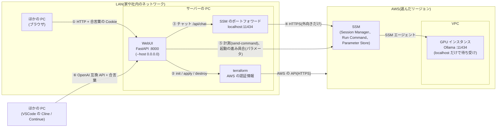

# LAN 内の PC から、立ち上げた GPU インスタンスにつながるまで

LAN 内のほかの PC のブラウザから、WebUI を動かしている PC(以下「サーバーの PC」)を通して、AWS に立ち上げた GPU インスタンスの Ollama を使う仕組み。

ほかの PC は AWS に直接つながらない。AWS の認証情報、terraform、SSM のポートフォワードは、どれもサーバーの PC のものを使う。



## つながる順番

| # | どこから | どこへ | 何で | 守り方 |
|---|---|---|---|---|
| ① | ほかの PC のブラウザ | サーバーの PC の WebUI(`:8000`) | HTTP。画面のファイルと `/api` | 合言葉(`LAUNCHPAD_ACCESS_TOKEN`)のログイン。送り元は `LAUNCHPAD_ALLOWED_CIDRS`(既定はプライベートアドレス)だけ |
| ② | WebUI | AWS | terraform(子プロセス)と boto3 | サーバーの PC の AWS の認証情報(環境変数や `~/.aws`) |
| ③ | WebUI | サーバーの PC の `localhost:11434` | HTTP(Ollama の `/api/chat`) | サーバーの PC の中だけで閉じる |
| ④ | SSM のポートフォワード | GPU インスタンスの `localhost:11434` | SSM Session Manager(`AWS-StartPortForwardingSession`)。サーバーの PC からも、インスタンスからも、AWS への外向きの HTTPS だけで張る | IAM。インスタンスのインバウンドは1つも開けない |
| ⑥ | ほかの PC の VSCode(Cline や Continue) | WebUI の `/api/environments/<環境ID>/openai/v1` | HTTP(OpenAI 互換 API)。WebUI が ③④ を通して Ollama の `/v1` に中継する | ① と同じ合言葉(API キーとして `Authorization: Bearer` で送る)と送り元の制限 |
| ⑤ | WebUI | GPU インスタンス | SSM Run Command(`send-command` で `launchpad.py bench`)と Parameter Store(`/llm-launchpad/<環境ID>/status`) | IAM。ポートフォワードは要らない |

## それぞれの役わり

### ① ほかの PC → サーバーの PC

* サーバーの PC で、合言葉を決めて `--host 0.0.0.0` で WebUI を起動する(`webui/README.md` の「LAN 内のほかの PC から使う」)
* ほかの PC のブラウザで `http://<サーバーの PC の IP アドレス>:8000` を開き、合言葉でログインする。ログインすると HttpOnly・SameSite=Strict の Cookie を受け取り、以後の `/api`(SSE の出力や CSV の保存を含む)はこの Cookie で通る
* 合言葉を決めていなければ、ほかの PC からの `/api` は断る(画面は合言葉の決め方を案内する)
* HTTP なので、合言葉と Cookie は LAN の中を暗号化せずに流れる。信頼できない人がいるネットワークでは使わない

### ② サーバーの PC → AWS(起動と削除)

* 画面の「はい」で、WebUI が `terraform/tfvars/<環境ID>.tfvars.json` を書き、`terraform init` と `apply` を子プロセスで動かす。削除は `destroy`
* 料金、事前チェック、環境の一覧は、WebUI が boto3 で AWS の API に問い合わせる
* どちらも、サーバーの PC の AWS の認証情報を使う。ほかの PC に認証情報は要らない

### ③④ チャット(サーバーの PC → インスタンスの Ollama)

* インスタンスの Ollama は、既定(`access_mode = ssm`)ではインスタンスの `localhost:11434` だけで待ち受け、セキュリティグループのインバウンドは開けない
* サーバーの PC で、terraform output の `ssm_port_forward_command` を動かしたままにする。起動の進み具合の画面にも出る

  ```sh
  aws ssm start-session --target i-xxxxxxxx --region ap-northeast-1 \
    --document-name AWS-StartPortForwardingSession \
    --parameters '{"portNumber":["11434"],"localPortNumber":["11434"]}'
  ```

  これで、サーバーの PC の `localhost:11434` が、インスタンスの `localhost:11434` につながる。SSM のセッションは、サーバーの PC とインスタンスのどちらからも AWS への外向きの HTTPS で張るので、インスタンスにパブリックな入口は要らない
* ほかの PC の画面で「チャットで試す」を使うと、ほかの PC → WebUI(①)→ サーバーの PC の `localhost:11434`(③)→ ポートフォワード(④)→ インスタンスの Ollama と届く。ほかの PC でポートフォワードを動かす必要はない
* ポートフォワードが止まっていると、チャットはそのコマンドをエラーに出す
* ポートフォワードは `localhost` だけで待ち受けるので、ほかの PC から `http://<サーバーの PC>:11434` に直接はつながらない。ほかの PC の Ollama のクライアントから使いたいときは、そのクライアントを動かす PC でポートフォワードを動かす(その PC にも AWS の認証情報が要る)

### ⑥ VSCode から使う(WebUI が中継する)

* VSCode の拡張機能(Cline や Continue)で接続先を「OpenAI 互換」にし、Base URL に `http://<サーバーの PC>:8000/api/environments/<環境ID>/openai/v1`、API キーに合言葉を入れる
* WebUI は受け取った要求を、③④ と同じ経路でインスタンスの Ollama の `/v1` に送り、応答(ストリーミングを含む)をそのまま返す
* VSCode の PC に AWS の認証情報もポートフォワードも要らない。要るのは、サーバーの PC でポートフォワードが動いていること
* もう1つのやり方として、VSCode の PC で自分でポートフォワードを動かし、`http://localhost:11434/v1` を使うこともできる。そのときは、その PC にも AWS の認証情報が要る

### ⑤ 計測と起動の進み具合(ポートフォワードは要らない)

* ベンチマークと比較モードの計測は、WebUI が SSM の `send-command` で、インスタンスの中の `launchpad.py bench` を動かす。インスタンスの中から Ollama に送るので、ネットワークの遅れは入らない
* 起動の進み具合は、インスタンスが SSM Parameter Store(`/llm-launchpad/<環境ID>/status`)に書く状態を、WebUI が読む
* どちらも AWS の API を通すだけなので、ポートフォワードを動かしていなくても使える

## 閉じたネットワーク(`network_mode = private`)のとき

* インスタンスは、インターネットへの経路がないプライベートサブネットに置く。SSM(`ssm`、`ec2messages`、`ssmmessages`)は VPC エンドポイント、S3 はゲートウェイエンドポイントでつなぐ
* つながる順番は上と同じ。④⑤は VPC エンドポイントを通る
* `access_mode = direct` は使えない(パブリック IP を付けないため)

## `access_mode = direct` のとき(パブリックなネットワークだけ)

* インスタンスの Ollama は `0.0.0.0:11434` で待ち受け、セキュリティグループで `allowed_cidrs` からの 11434 だけを開ける。`allowed_cidrs` を空にすると、terraform を動かした PC のグローバル IP(/32)になる
* `ollama_endpoint` は `http://<インスタンスのパブリック IP>:11434` になり、ポートフォワードは要らない
* LAN のほかの PC から Ollama に直接つなぐなら、`allowed_cidrs` に LAN の出口のグローバル IP を入れる。暗号化も認証もない HTTP がインターネットを流れるので、既定の ssm をすすめる
* 画面の起動の確認からは選べない。tfvars を手で書いて terraform を動かす

## Bedrock の環境のとき

* GPU インスタンスは作らない。チャットと計測は、WebUI が AWS の API で Lambda を呼び、Lambda が VPC の中から bedrock-runtime のエンドポイント経由で Bedrock に送る
* ポートフォワードは要らない。ほかの PC からは ①② だけで使える

## まとめ:どこに何が要るか

| | ほかの PC | サーバーの PC | GPU インスタンス |
|---|---|---|---|
| 要るもの | ブラウザ(または VSCode の拡張機能)と合言葉 | WebUI、terraform、AWS CLI と Session Manager プラグイン、AWS の認証情報 | (terraform が作る)Ollama、SSM エージェント |
| 開けるポート | なし | `8000`(LAN の中だけ) | なし(ssm のとき) |
| 動かし続けるもの | なし | WebUI。チャットするときは SSM のポートフォワード | なし |
