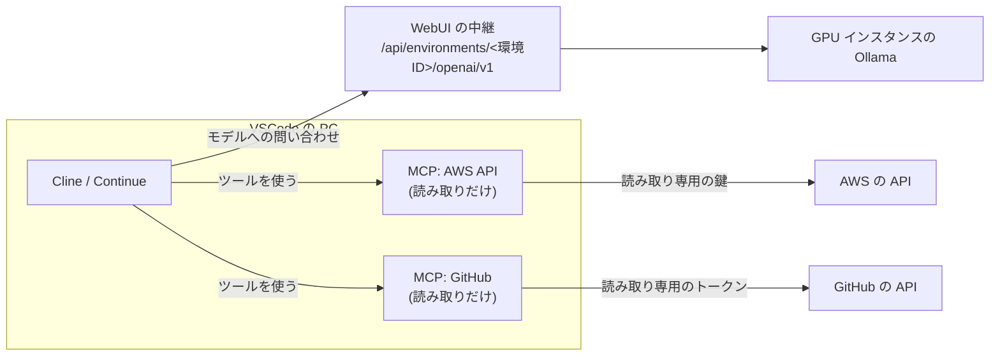

# VSCode のエージェントに、AWS と GitHub を読み取りだけで使わせる(MCP)

立ち上げた GPU インスタンスのモデルを、VSCode の Cline や Continue から使うとき([webui/README.md](../webui/README.md) の「VSCode(Cline や Continue)から使う」)に、MCP サーバーを足して、AWS の様子と GitHub のリポジトリの中身を**読み取りだけ**で見られるようにする手順。

## MCP サーバーはどこで動くか

MCP サーバーは llm-launchpad(WebUI や Ollama)ではなく、**VSCode の拡張機能に設定して、VSCode の PC で動かす**。



1. モデルが「このツールを使いたい」と答える
2. 拡張機能が MCP サーバーを動かし、AWS や GitHub に問い合わせる
3. 結果をモデルに渡し、モデルが続きを答える

MCP サーバーは VSCode の PC で動くので、**その PC に AWS の鍵と GitHub のトークンが要る**。WebUI の中継を使えばモデルのために AWS の鍵は要らないが、AWS の MCP には要る。そのため、鍵は読み取りだけのものに絞る(下の手順)。

## 読み取りだけにする考え方

読み取りだけにする手段を2つ重ねる。

| | AWS | GitHub |
|---|---|---|
| 鍵の権限(一番大事) | `ReadOnlyAccess` か `ViewOnlyAccess` だけを付けた IAM ユーザー(またはロール) | 対象のリポジトリだけ、Contents: Read-only の Fine-grained personal access token |
| MCP サーバーの設定 | `READ_OPERATIONS_ONLY=true` | `GITHUB_READ_ONLY=1` |

MCP サーバーの設定だけに頼らない。サーバーの不具合や設定ミスがあっても、鍵に書き込みの権限がなければ、AWS や GitHub の側で断られる。

## 1. AWS の読み取り専用の鍵を作る

### どちらのポリシーにするか

| AWS 管理ポリシー | 読めるもの | 向いているとき |
|---|---|---|
| `ViewOnlyAccess`(`arn:aws:iam::aws:policy/job-function/ViewOnlyAccess`) | リソースの一覧と設定。データの中身は読まない | 何があるか、どうなっているかを見たいだけのとき(すすめる) |
| `ReadOnlyAccess`(`arn:aws:iam::aws:policy/ReadOnlyAccess`) | ほぼすべての読み取り。S3 のオブジェクトの中身なども読める | ログや設定ファイルの中身まで読ませたいとき |

どちらも AWS が中身を変えることがあるので、付ける前に IAM のコンソールで中身を確かめる。

### IAM Identity Center(SSO)を使っているとき(すすめる)

長く使える鍵を PC に置かずに済む。

1. IAM Identity Center で、`ViewOnlyAccess`(または `ReadOnlyAccess`)の許可セットを作り、自分に割り当てる
2. VSCode の PC で、その許可セットのプロファイルを作る

   ```sh
   aws configure sso --profile readonly
   aws sso login --profile readonly    # 期限が切れたらもう一度
   ```

### IAM ユーザーで作るとき

管理者の権限がある端末で実行する。ユーザー名は例。

```sh
aws iam create-user --user-name llm-launchpad-mcp-readonly

aws iam attach-user-policy --user-name llm-launchpad-mcp-readonly \
  --policy-arn arn:aws:iam::aws:policy/job-function/ViewOnlyAccess

aws iam create-access-key --user-name llm-launchpad-mcp-readonly
```

最後のコマンドが出すアクセスキーを、VSCode の PC でプロファイルに入れる。

```sh
aws configure --profile readonly
```

* アクセスキーは長く使えるので、使わなくなったら `aws iam delete-access-key` で消す。定期的に作り直す
* コンソールへのログインのパスワードは作らない

### 中身まで読ませたくないもの(任意)

`ReadOnlyAccess` を使うときなど、データの中身や秘密の値を確実に読ませたくなければ、明示的に断るポリシーを足す。Deny は Allow より強いので、管理ポリシーの中身が変わっても効く。

```sh
aws iam put-user-policy --user-name llm-launchpad-mcp-readonly \
  --policy-name deny-data-and-secrets \
  --policy-document '{
    "Version": "2012-10-17",
    "Statement": [{
      "Effect": "Deny",
      "Action": [
        "s3:GetObject",
        "secretsmanager:GetSecretValue",
        "ssm:GetParameter",
        "ssm:GetParameters",
        "ssm:GetParametersByPath",
        "kms:Decrypt"
      ],
      "Resource": "*"
    }]
  }'
```

### 確かめる

```sh
aws sts get-caller-identity --profile readonly           # このユーザー(ロール)になっている
aws ec2 describe-instances --profile readonly --max-items 1  # 読める
aws ec2 create-tags --profile readonly --resources i-0000000000000000 --tags Key=x,Value=y
# → UnauthorizedOperation になれば、書き込みは断られている
```

## 2. GitHub の読み取り専用のトークンを作る

1. GitHub の Settings → Developer settings → Personal access tokens → **Fine-grained tokens** → Generate new token
2. Repository access で **Only select repositories** を選び、読ませたいリポジトリだけを選ぶ
3. Repository permissions で **Contents: Read-only** にする(Metadata: Read-only は自動で付く)。ほかは付けない。Issues や Pull requests も読ませたいときだけ、それぞれ Read-only を足す
4. 有効期限を決める(短いほうがよい)

Classic のトークンは、リポジトリ単位で絞れず、読み取りだけにもできない(`repo` を付けると書き込みもできる)ので使わない。

## 3. 拡張機能に設定する

要るもの: AWS の MCP は `uvx`([uv](https://docs.astral.sh/uv/))、GitHub の MCP は Docker。

使う MCP サーバー:

* AWS: AWS 公式の [AWS API MCP Server](https://github.com/awslabs/mcp)(`awslabs.aws-api-mcp-server`)。AWS CLI の操作をツールとして使える
* GitHub: GitHub 公式の [github-mcp-server](https://github.com/github/github-mcp-server)

### Cline

MCP Servers の画面の「Configure」で開く `cline_mcp_settings.json` に足す。

```json
{
  "mcpServers": {
    "aws": {
      "command": "uvx",
      "args": ["awslabs.aws-api-mcp-server@latest"],
      "env": {
        "AWS_PROFILE": "readonly",
        "AWS_REGION": "ap-northeast-1",
        "READ_OPERATIONS_ONLY": "true"
      }
    },
    "github": {
      "command": "docker",
      "args": [
        "run", "-i", "--rm",
        "-e", "GITHUB_PERSONAL_ACCESS_TOKEN",
        "-e", "GITHUB_READ_ONLY",
        "ghcr.io/github/github-mcp-server"
      ],
      "env": {
        "GITHUB_PERSONAL_ACCESS_TOKEN": "<読み取り専用のトークン>",
        "GITHUB_READ_ONLY": "1"
      }
    }
  }
}
```

### Continue

`config.yaml` に足す。MCP のツールはエージェントモードで使える。

```yaml
mcpServers:
  - name: aws
    command: uvx
    args: ["awslabs.aws-api-mcp-server@latest"]
    env:
      AWS_PROFILE: readonly
      AWS_REGION: ap-northeast-1
      READ_OPERATIONS_ONLY: "true"
  - name: github
    command: docker
    args: ["run", "-i", "--rm", "-e", "GITHUB_PERSONAL_ACCESS_TOKEN", "-e", "GITHUB_READ_ONLY", "ghcr.io/github/github-mcp-server"]
    env:
      GITHUB_PERSONAL_ACCESS_TOKEN: "<読み取り専用のトークン>"
      GITHUB_READ_ONLY: "1"
```

パッケージ名、環境変数の名前、設定ファイルの書き方は、どちらも変わることがある。入れる前に、それぞれの README で確かめる。

### 試す

エージェントに次のように頼み、ツールを使って答えるか確かめる。

* 「ap-northeast-1 で動いている EC2 インスタンスを一覧にして」(AWS)
* 「yosuke318/llm-launchpad の webui/README.md の見出しを並べて」(GitHub)
* 「このインスタンスにタグを付けて」→ 断られることも確かめる

## 気をつけること

* **モデルの力**: ツールを正しく呼べるかはモデルしだい。`qwen3:32b` や `gpt-oss` くらいのモデルを、コンテキスト長 32768 以上で起動する。`describe` の結果や大きなファイルはコンテキストを多く使う
* **読んだ内容が指示に化けること**: リポジトリのファイルや AWS のタグに書かれた文章を、モデルが指示と取り違えることがある。鍵が読み取りだけなら被害は読める範囲にとどまるが、Cline はターミナルでコマンドも動かせる。コマンドの実行や書き込みの承認は自動にしない
* **トークンの置き場所**: 設定ファイルにトークンを直接書くと、バックアップや画面の共有で漏れやすい。OS のキーチェーンや環境変数から渡せるか、拡張機能の説明を確かめる。設定ファイルを git に入れない
* **読んだ内容はモデルに渡る**: AWS や GitHub から読んだものは、WebUI の中継を通って GPU インスタンスのモデルに送られる(LAN の中は HTTP)。インスタンスは自分の AWS アカウントの中なので外には出ないが、LAN の中は暗号化されずに流れる
